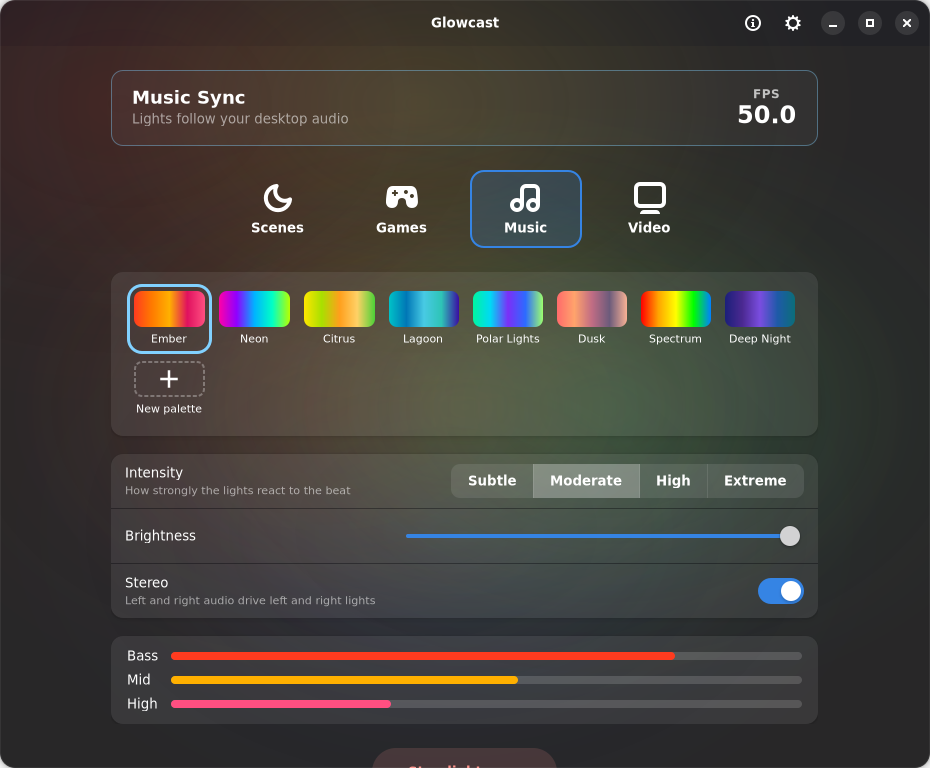

# Glowcast

Sync your Philips Hue lights with your screen, your games and your music, or
set a scene, on Linux with Wayland. Glowcast follows the official Hue Sync app
for Windows and macOS, with the same modes, settings and names, in a native
GNOME app.



## Features

- **Video and Games:** the lights follow your screen through your Hue
  entertainment area. Several monitors are synced as one wide screen. Games
  reacts faster and punchier than Video, and switching between them is instant.
  - Intensity: Subtle, Moderate, High, Extreme
  - Use audio for effect: shots and explosions make the lights flare
  - Capture area: drag across the live preview to sync only part of the screen
  - Background lighting: a minimum light level, whatever the screen shows
  - Black bars of letterboxed films are ignored automatically
- **Music:** the lights follow your desktop audio with colour palettes,
  including your own. Stereo moves the effect between your left and right
  lights, and a vocal filter makes them follow the instruments, not the singer.
- **Scenes:** a scene gallery (Relax, Read, Concentrate, Energize and more),
  your own scenes, and the scenes on your bridge, with optional Dynamics.
- **The window glows with your lights** and pulses along with them.
- **Switch modes while syncing**, without restarting.
- **Keyboard shortcuts** that also work while Glowcast is in the background.
- **Plays nicely with others:** if the Hue app or another app takes over the
  lights, Glowcast hands them over instead of grabbing them back.
- **Settings like Hue Sync's:** start at login, start syncing or turn on a scene
  at launch, lights off on close, sync delay for wireless displays, audio
  device, light channels, notifications and a tray icon.

Nothing you watch or hear leaves your computer: colours are worked out locally,
and only light colours are sent to your bridge.

## Requirements

- A Philips Hue Bridge with an entertainment area, set up in the official Hue
  app (Settings > Entertainment areas).
- A Wayland desktop with xdg-desktop-portal, such as GNOME or KDE Plasma.
- For the tray icon on GNOME: the AppIndicator extension.
- For keyboard shortcuts: the GlobalShortcuts portal (GNOME 48 or newer, KDE
  Plasma 6).

## First start

1. Open **Settings > Hue Bridge** and choose **Connect New Bridge**. Glowcast
   finds your bridge and asks you to press its button.
2. Pick your entertainment area.
3. Choose a mode and press **Start light sync**. Video and Games ask once which
   monitors to share, and remember your choice.

## Development

Glowcast is Python with GTK 4 and libadwaita. Its only dependencies besides
the GNOME platform are PyGObject and numpy; the Hue bridge, bridge discovery,
the tray icon and the portals all use the standard library and Gio.

```bash
dev/build.sh        # build and install the Flatpak (needs org.flatpak.Builder)
dev/run.sh          # run the code in src/ inside it
dev/screenshots.sh  # render every mode offscreen into dev/screenshots/
```

Run the tests with `pytest`, and check style with `ruff check` and
`ruff format --check`. Dependabot and Renovate keep the dependencies current.

## Credits

Glowcast started as a fork of [Lumux](https://github.com/enginkirmaci/lumux) by
Engin Kırmacı, which brought Hue entertainment sync to Wayland. Much of the sync
logic comes from Lumux; Glowcast gives it its own look and way of working. Thank
you!

Glowcast is not affiliated with, endorsed by or connected to Signify or Philips
Hue. Philips Hue and Hue Sync are trademarks of Signify Holding.

## License

MIT, see [LICENSE](LICENSE). Lumux's original copyright notice is kept there,
as its licence requires.
